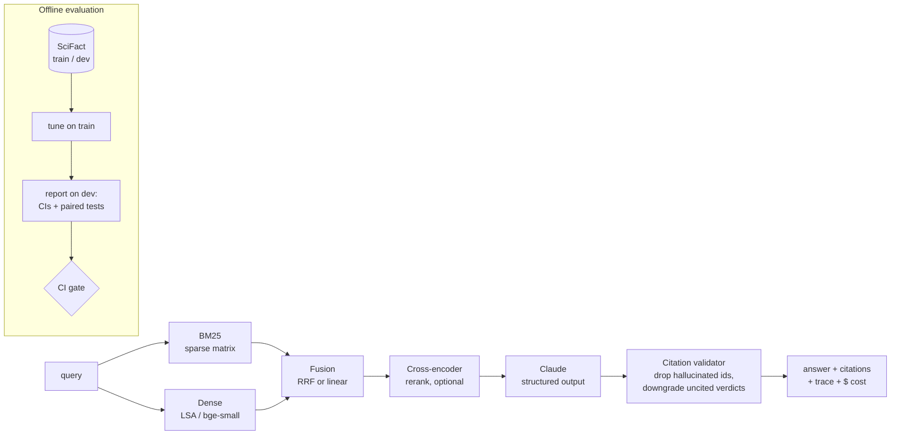

# grounded-rag

**Evaluation-driven retrieval-augmented generation.** It does hybrid retrieval, gives answers with verified citations, and has a benchmark harness with confidence intervals and significance tests. A CI quality gate fails any pull request that makes retrieval worse.

Most RAG demos show that a pipeline *runs*. This project shows how to tell whether a change made it *better*. Every retrieval and generation decision is measured on a public benchmark ([SciFact](https://github.com/allenai/scifact)). Hyperparameters are tuned on the train split and reported on dev, and every comparison carries a paired significance test.

```
SciFact dev, 300 claims, 5,183 abstracts             nDCG@10   Δ vs BM25          p50 latency
BM25 (this repo, Lucene defaults)                     0.662     —                  0.2 ms
BM25 (published BEIR baseline, Elasticsearch)         0.665     reproduced ✓
Hybrid BM25 + LSA, tuned on train (k1, b and weight)  0.674     +0.012 (p=0.023)   3.9 ms
  ...of which the blend itself, vs tuned BM25          0.674     +0.006 (p=0.105, not significant)
Hybrid BM25 + LSA, naive equal-weight RRF             0.578     −0.084 (p<0.001)   3.9 ms
```

The fully tuned system beats standard BM25, but neither the BM25 tuning nor the blend is significant on its own. The firm finding is the negative one: naive blending clearly hurts. See [Results](#results-and-findings).

## What this project demonstrates

| Skill | Where |
|---|---|
| IR fundamentals: BM25 written from scratch on sparse matrices, matching the published BEIR baseline | [`retrieval/bm25.py`](src/grounded/retrieval/bm25.py) |
| Hybrid search: RRF and linear fusion, RM3 query expansion, cross-encoder reranking | [`retrieval/`](src/grounded/retrieval) |
| Grounded generation with Claude: JSON-schema structured output, citation validation, abstention, prompt-injection hygiene | [`generation/`](src/grounded/generation) |
| Evaluation rigour: bootstrap CIs, paired significance tests, train/dev discipline, LLM-as-judge faithfulness, synthetic eval sets | [`eval/`](src/grounded/eval) |
| Production engineering: typed configs, tracing, per-query cost accounting, FastAPI service, Docker, CI quality gate | [`api/`](src/grounded/api), [`.github/workflows/ci.yml`](.github/workflows/ci.yml) |

## Architecture



**[`docs/architecture.pdf`](docs/architecture.pdf)** is a printable three-page schematic. Page 1 shows how the components fit together on the request path. Page 2 shows how quality is measured and protected in CI. Page 3 is a component reference plus a step-by-step walkthrough of one request. To regenerate it: `pip install reportlab && python docs/make_schematic.py`.

Every request returns a trace with per-stage latency, token counts and USD cost. The values below are illustrative:
`{"name": "generate", "duration_ms": 2140, "attributes": {"input_tokens": 2311, "cost_usd": 0.0187}}`.

## Results and findings

The full table with 95% bootstrap CIs is in [`reports/retrieval_scifact_dev.md`](reports/retrieval_scifact_dev.md). Tuning grids are in [`reports/tuning.json`](reports/tuning.json).

| System (SciFact dev) | nDCG@10 | Recall@100 | Δ nDCG@10 vs BM25 |
|---|---|---|---|
| `bm25`: k1=0.9, b=0.4 | 0.662 | 0.906 | — |
| `bm25_tuned`: k1=1.5, b=0.3, chosen on train | 0.668 | 0.903 | +0.006 (p=0.14, n.s.) |
| `bm25_rm3`: pseudo-relevance feedback | 0.657 | 0.905 | −0.005 (n.s.) |
| `bm25_chunk100`: 100-word passages | 0.657 | 0.885 | −0.005 (n.s.) |
| `dense_lsa`: TF-IDF + SVD, 256-d | 0.485 | 0.863 | −0.177 ✱ |
| `hybrid_lsa_rrf`: equal-weight RRF | 0.578 | **0.931** | −0.084 ✱ |
| `hybrid_lsa_tuned`: tuned BM25 + linear blend, dense weight 0.1 | **0.674** | 0.919 | +0.012 ✱ |

`hybrid_lsa_tuned` changes two things at once: it uses the tuned BM25 settings *and* adds the blend. To see what each change contributes, compare it with the right baseline:

| Effect isolated | Comparison | Δ nDCG@10 | p | Verdict |
|---|---|---|---|---|
| Tuning + blend together | `hybrid_lsa_tuned` vs `bm25` | +0.012 | 0.023 | significant |
| BM25 tuning only | `bm25_tuned` vs `bm25` | +0.006 | 0.138 | not significant |
| Blend only | `hybrid_lsa_tuned` vs `bm25_tuned` | +0.006 | 0.105 | not significant |
| Naive blend | `hybrid_lsa_rrf` vs `bm25` | −0.084 | <0.001 | significantly worse |

Reproduce the blend-only row with `grounded eval retrieval --config configs/bm25_tuned.yaml --config configs/hybrid_lsa_tuned.yaml --baseline bm25_tuned`.

What the numbers say:

1. **Reproducing a published baseline comes first.** The from-scratch BM25 scores 0.662 against BEIR's 0.665. Without that check, the rest of the table would be uninterpretable.
2. **Hybrid is not free.** Equal-weight RRF with a weak dense retriever *loses* 0.084 nDCG@10. A train-tuned, mostly-BM25 blend (90/10) avoids the loss. The full tuned system beats standard BM25 (+0.012, p=0.023), but against tuned BM25 the blend adds only +0.006 (p=0.105), which is not significant. The likely reason is that LSA is a weak semantic retriever. A neural embedder (`make bench-neural`) is the experiment that would settle whether blending helps on its own.
3. **Different metrics favour different systems.** Naive RRF has the worst top-10 ranking but the best recall@100 (0.931). That makes it the right candidate generator for a reranker and the wrong final ranker. Hence `hybrid_bge_rerank.yaml`.
4. **Isolate each change.** The BM25 grid and the blend each moved nDCG by about +0.006, and neither is significant alone (p=0.14, p=0.11). Together they are significant. Without separate paired tests, it would be easy to credit the whole gain to hybrid search.
5. **Chunking and RM3 do not help here.** SciFact abstracts are short and claims are specific, so whole-abstract chunks win. This finding is corpus-specific and should be re-measured on long documents.

### End-to-end claim verification (needs an API key)

`grounded eval verify` runs retrieve → Claude → verdict for each SciFact claim. It scores the result against gold labels with no LLM judge needed:

- **verdict accuracy and macro-F1** over SUPPORT / CONTRADICT / NOT_ENOUGH_INFO, against a majority-class baseline of 0.413;
- **citation precision and recall** against the gold evidence abstracts;
- **evidence-in-context rate**, which separates retrieval failures from reasoning failures;
- **measured $/claim and p50 latency.**

```bash
export ANTHROPIC_API_KEY=...
make verify LIMIT=300   # prints running cost; use a smaller LIMIT first
```

## Quickstart

```bash
make install            # uv venv + editable install with dev extras
make test lint          # 57 tests: unit, API, mocked Claude client
make data tune bench    # download SciFact, tune on train, benchmark on dev (~1 min, CPU only)
make gate               # the same quality gate CI runs
make serve              # index SciFact and serve the API on :8000
```

Use your own documents:

```bash
grounded index --config configs/bm25_tuned.yaml --corpus path/to/docs/ --out indexes/mine.pkl
grounded search "how do I rotate the API keys?" --index indexes/mine.pkl
grounded ask "how do I rotate the API keys?" --index indexes/mine.pkl     # needs ANTHROPIC_API_KEY

# No labelled queries? Generate an eval set, then score faithfulness with an LLM judge.
grounded synth --config configs/bm25_tuned.yaml --corpus path/to/docs/ --out eval/mine.jsonl --n 100
grounded eval qa --config configs/bm25_tuned.yaml --corpus path/to/docs/ --examples eval/mine.jsonl
```

### API

| Endpoint | Body | Returns |
|---|---|---|
| `GET /healthz` | — | config name, index size, whether generation is enabled |
| `POST /v1/search` | `{"query", "k"}` | ranked chunks with scores (no LLM) |
| `POST /v1/answer` | `{"question"}` | answer, validated citations, sources, trace, usage |
| `POST /v1/verify` | `{"claim"}` | SUPPORT / CONTRADICT / NOT_ENOUGH_INFO with evidence |

`docker build -t grounded-rag . && docker run -p 8000:8000 -e ANTHROPIC_API_KEY grounded-rag` serves a prebuilt SciFact index.

## Design decisions

- **Structured output instead of free-text parsing.** Claude returns JSON constrained by a schema (`output_config.format`). Citations are integer source ids, so they can be checked mechanically.
- **The model's citations are validated, not trusted.** Out-of-range source ids are dropped and logged. An answer with no valid citation counts as an abstention. A SUPPORT or CONTRADICT verdict with no valid evidence is downgraded to NOT_ENOUGH_INFO.
- **Retrieved text is treated as untrusted.** Sources are HTML-escaped inside `<source>` tags, and the system prompt says to ignore instructions inside them. The test corpus includes a document with a prompt-injection payload.
- **Refusals and failures are explicit.** `stop_reason == "refusal"` raises `LLMRefusal` (HTTP 422), and truncation or schema violations raise `LLMError` (HTTP 502). Server-side refusal fallback is enabled by default. Eval runs count errors instead of silently dropping them.
- **Search is exact, not approximate.** Brute-force cosine over 5k × 256 floats takes about 3 ms. An ANN index would add a recall loss and a dependency for no latency benefit at this scale. The `Retriever` protocol makes swapping in FAISS or HNSW a one-file change when the corpus grows.
- **LSA is the offline dense baseline.** CI and the default benchmarks need no model download or GPU. Neural embeddings (`bge-small`) and cross-encoder reranking are one `pip install -e '.[neural]'` away (`make bench-neural`).
- **Configs are data.** Each YAML file in `configs/` is one system under test, validated with `extra="forbid"` so a typo fails loudly instead of silently using a default.

## Project layout

```
src/grounded/
  ingest/       sentence-aware chunking, corpus loaders
  retrieval/    bm25.py, dense.py, hybrid.py, rerank.py
  generation/   Claude client, prompts, schemas, citation-validating answerer
  eval/         datasets, metrics + significance tests, runners, judge, synth, tuning, gate
  api/          FastAPI service
  pipeline.py   retrieve → rerank → generate, with tracing and cost accounting
configs/        one YAML per system under test
docs/           architecture.pdf and the script that draws it
eval/           CI metric floors
reports/        committed benchmark results
tests/          57 tests; Claude is mocked at the HTTP layer
```

## Limitations and next steps

- Neural dense retrieval and reranking results are not in the committed report. They need the `neural` extra and a model download (`make bench-neural`).
- The LLM judge has not been calibrated against human labels. Before relying on `eval qa` scores, hand-label about 50 judgements and report agreement.
- SciFact is a single domain (biomedical abstracts). The harness is dataset-agnostic: add a loader and a config.
- Next: query rewriting (HyDE), prompt caching for repeated context, and an online feedback loop that adds thumbs-down answers to the eval set.

## License

MIT. SciFact is distributed under CC BY-NC 2.0 and is downloaded at runtime, not redistributed.
